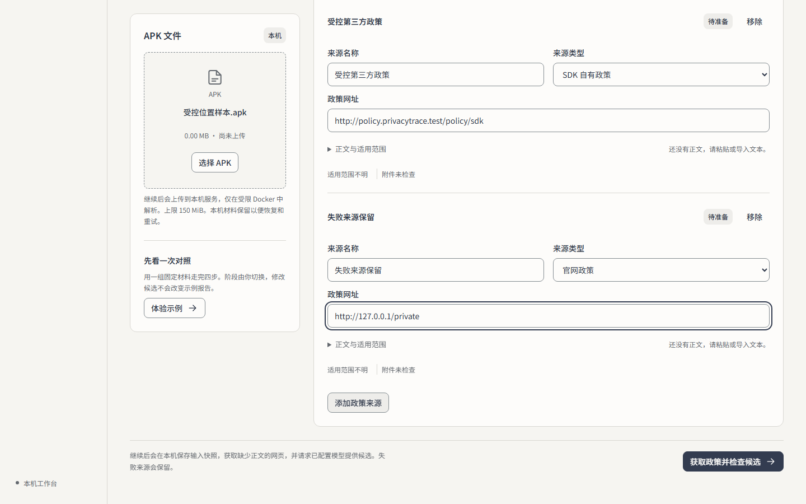
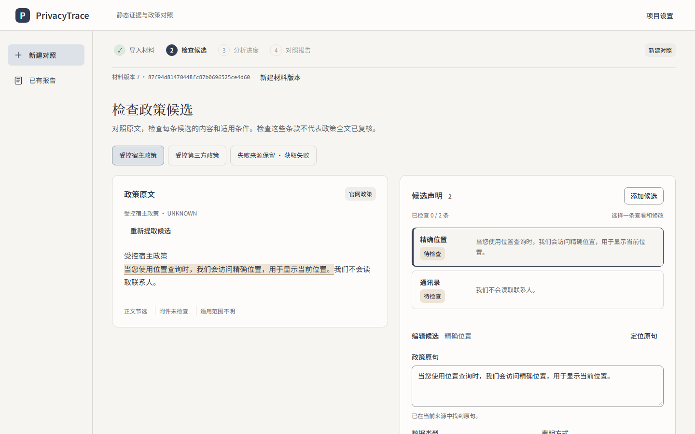
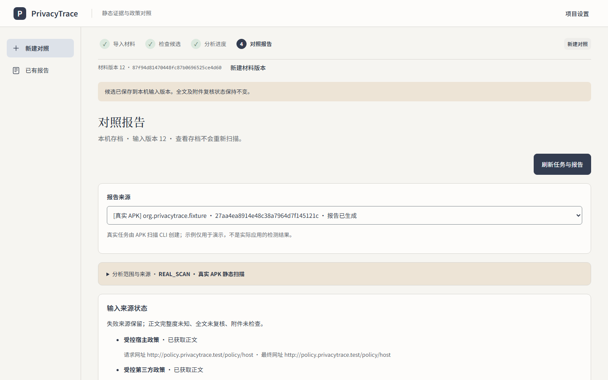
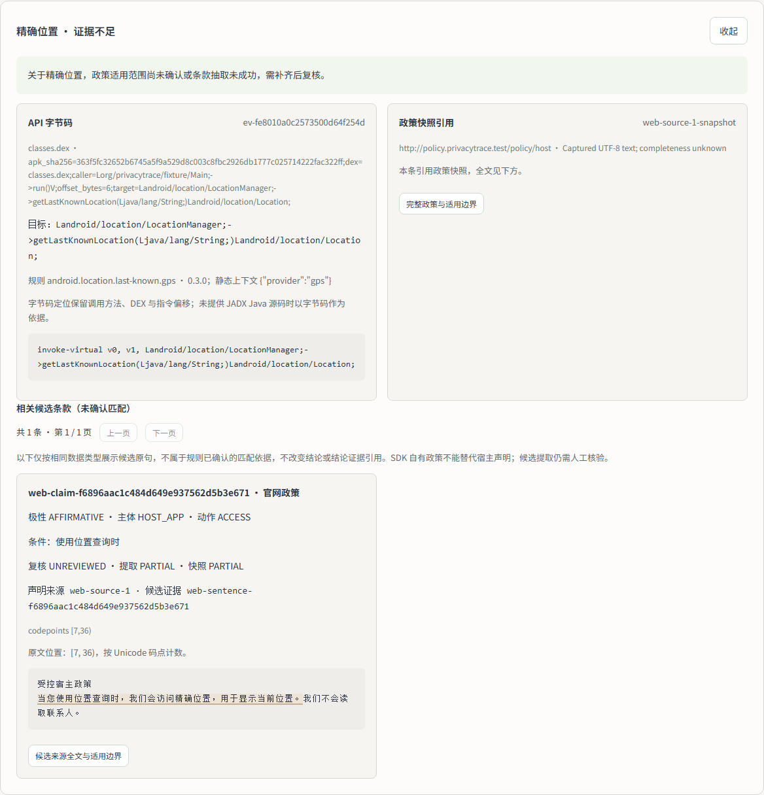

<a id="readme-top"></a>

<h1 align="center">PrivacyTrace</h1>

<p align="center">
  读取 Android 安装包里能静态看到的隐私线索，和隐私政策原文对照，把每条线索落到代码位置与政策原句上。
  <br>
  <strong>只对照，不判定</strong>：不判断应用是否真的收集或外传数据，不推断数据流向，也不判断安全性和合法性。
</p>

<p align="center">
  <a href="https://github.com/MrEcho114/PrivacyTrace/actions/workflows/check.yml"></a>
  <a href="https://nodejs.org/"></a>
  <a href="https://www.python.org/"></a>
  <a href="LICENSE"></a>
</p>

<p align="center">
  <a href="#快速开始">快速开始</a> ·
  <a href="showcase/privacytrace/delivery/PrivacyTrace-1080p.mp4">演示视频（120 秒）</a> ·
  <a href="#文档索引">文档</a> ·
  <a href="https://github.com/MrEcho114/PrivacyTrace/issues/128">验收记录</a> ·
  <a href="CONTRIBUTING.md">参与贡献</a>
</p>

<details>
<summary>目录</summary>

- [这是什么](#这是什么)
- [现在能用到什么](#现在能用到什么)
- [界面预览](#界面预览)
- [快速开始](#快速开始)
  - [环境要求](#环境要求)
  - [本机启动](#本机启动)
  - [五分钟走一遍](#五分钟走一遍)
- [使用](#使用)
  - [Android 客户端](#android-客户端)
  - [浏览器工作台](#浏览器工作台)
  - [真实 APK 的隔离扫描](#真实-apk-的隔离扫描)
  - [验收脚本](#验收脚本)
- [架构](#架构)
- [能力与边界](#能力与边界)
- [评测与验证](#评测与验证)
- [部署](#部署)
- [进度](#进度)
- [贡献与协作](#贡献与协作)
- [文档索引](#文档索引)
- [许可](#许可)
- [人工智能工具使用与开源披露](#人工智能工具使用与开源披露)
- [安全声明](#安全声明)

</details>

## 这是什么

PrivacyTrace 是一个面向 Android 的**隐私对照工具**，不是安全扫描器，也不是合规判定器。它读取 APK 里静态可见的隐私线索，把每条线索和隐私政策原文摆在一起。它只回答两件事：代码里有没有这个线索，政策里有没有这句话。至于这个应用是否真的在收集、有没有外传、合不合法，都不在结论范围内。

产品只有一条正规入口：**Android App**，即 [`apps/mobile`](apps/mobile) 的 Tauri 2 壳加载移动界面。零安装的补充路径是断网只读的离线回放包。浏览器工作台和 Web 构建产物是 App 的界面层、工程验收介质与离线回放载体，不是第二个客户端（定义见 [ADR-0004](docs/adr/0004-client-is-android-app.md)）。

项目准备参加 2026 年第十四届数媒竞赛。API、隔离扫描与部署基线已在 `main` 上，Android 客户端主流程也已合入。2026-10-22 的提交前最终验收已收口，结论是**未全部通过**：失败项与未跑项按"在历史里留痕"处理，不按规格通过，详见 [#128](https://github.com/MrEcho114/PrivacyTrace/issues/128)。正式提交与回执由 [#107](https://github.com/MrEcho114/PrivacyTrace/issues/107) 跟踪，工程节点不等于赛事结果。

<p align="right">(<a href="#readme-top">回到顶部</a>)</p>

## 现在能用到什么

- **工程演示夹具**（界面上仍叫「体验示例」）：不用 APK、Docker 或模型 Key，在浏览器里用固定材料走完导入、候选、进度、报告四步，查看代码线索、政策原句和证据定位。它是工程用途的夹具，不是客户端，也不表示正在分析所选 APK。
- **工程与本机复核**：在浏览器工作台上传单个 APK 或 base 加全部 splits，从 manifest 提取政策候选网址并抓取正文，也可以手工补入；确认候选后在 Docker 隔离 Worker 里静态扫描，再查看作业、报告和证据下钻。这条通道用于工程调试与本机复核，不是客户端。
- **Android 客户端**：Tauri 2 客户端可以选择已安装应用、确认包集合、上传、补政策、发起分析并打开同一任务的报告。主流程已合入 `main`；最终验收未全部通过，缺口见 [#128](https://github.com/MrEcho114/PrivacyTrace/issues/128)。
- **受控评测**：六个源码场景（C01–C06）和扩展版新增的 C07–C12，合计十二个源码场景；三种方案使用同一份材料对照，报告可以打包成断网只读回放。
- **部署基线**：API、Web、PostgreSQL、Redis、Celery 和 Runner 的容器配置与验收脚本已经就位；生产启动门禁保持关闭，没有公网实例。

<p align="right">(<a href="#readme-top">回到顶部</a>)</p>

## 界面预览

| 导入 | 候选 |
| :---: | :---: |
| <br>*选文件只准备输入，点继续才上传* | <br>*确认政策候选后才进入分析* |

| 报告 | 证据下钻 |
| :---: | :---: |
| <br>*按来源对照，结论指得到代码位置* | <br>*线索定位到文件与方法，并对照政策原句* |

截图来自示例材料（构造的 APK 与人工短政策）下的真实 Chromium 捕获，原始 PNG 未涂改，**不是一次真实 App 扫描**。捕获时间、视口与哈希见 [素材与制作来源](showcase/privacytrace/ASSETS.md)；完整流程见 120 秒[演示视频](showcase/privacytrace/delivery/PrivacyTrace-1080p.mp4)。

<p align="right">(<a href="#readme-top">回到顶部</a>)</p>

## 快速开始

### 环境要求

- **Node.js** 24（或 22.12+）
- **Python** 3.11–3.13，依赖用 [uv](https://docs.astral.sh/uv/) 管理
- **Docker** 仅在真实 APK 的隔离扫描时需要
- **Android 客户端**另需 Rust 与 Android 工具链，见 [Android 客户端](#android-客户端)

### 本机启动

在仓库根目录开两个终端：

```bash
# 终端 1：API（127.0.0.1:8000）
npm ci
uv sync --project apps/api --locked --extra worker
uv run --project apps/api --locked --extra worker uvicorn privacytrace.main:app --host 127.0.0.1 --port 8000
```

```bash
# 终端 2：Web（127.0.0.1:5173）
npm run dev
```

打开 http://127.0.0.1:5173。没连上 API 时仍可用“体验示例”；连上之后才能上传 APK、抓取政策、保存候选和启动扫描。选文件只准备输入，点继续才上传；保存候选并开始分析才启动扫描。政策完整度、正文取得情况和附件检查状态会一直显示。Web 的模型凭证只保存在后端，模型抽取默认关闭。

### 五分钟走一遍

1. 按上面的命令启动 API 与 Web。
2. 打开 http://127.0.0.1:5173，点“体验示例”。这是工程夹具，不需要 APK、Docker 或模型 Key。
3. 走完导入 → 候选 → 进度 → 报告四步，再点进任一线索，看代码位置与政策原句。
4. 要分析真实 APK：先装 Docker，按[真实 APK 的隔离扫描](#真实-apk-的隔离扫描)构建 Worker 镜像，再从工作台上传。

<p align="right">(<a href="#readme-top">回到顶部</a>)</p>

## 使用

### Android 客户端

唯一客户端是 Android App。它在 [`apps/mobile`](apps/mobile)，用 Tauri 2 复用 Web 前端，原生模块负责读取已安装应用和上传。先在仓库根目录执行 `npm ci && npm run build`，再进客户端目录：

```bash
cd apps/mobile
npm ci
npm run android:prepare
npm run android:build
```

需要 Rust 和 Android 工具链；初始化固定 API 36，关闭备份与明文传输。产物是 debug APK，只证明当前 ABI 和本机环境，不代表真机矩阵已经验过。个人模型 Key 保存在设备原生侧，只发往用户配置的 HTTPS Chat Completions 地址，不经过 WebView 和 JavaScript；不支持流式输出，也不会自动重试。模型端点不能与分析实例同源。细节见 [客户端说明](apps/mobile/README.md)。

### 浏览器工作台

浏览器工作台是工程与本机复核通道，不是第二个客户端。上传单个 APK 或 base 加全部 splits，从 manifest 提取政策候选网址并抓取正文，也可以手工补入；确认候选后在 Docker 隔离 Worker 里静态扫描，再查看作业、报告和证据下钻。界面与客户端共用同一套移动界面构建产物，因此这里看到的状态与报告结构一致，但它不提供选应用、读包集合这类原生能力。

### 真实 APK 的隔离扫描

未知 APK 只在 Docker 隔离环境里解析，宿主机 CLI 负责调用容器。

构建 Worker 镜像：

- Linux：`docker build -f apps/api/worker.Dockerfile -t privacytrace-worker:s1 .`
- Windows WSL2（PowerShell）：

  ```powershell
  $root = (wsl.exe -d Ubuntu-24.04 --exec wslpath -u $PWD.Path).Trim()
  wsl.exe -d Ubuntu-24.04 --exec docker build --file "$root/apps/api/worker.Dockerfile" --tag privacytrace-worker:s1 $root
  ```

政策摄取需要准备好的纯文本 raw 和 candidates 文件，会在指定的新目录生成不可变快照，不覆盖旧快照。原文里有重复句子时，每条候选要给出自己的起止偏移。扫描 Job ID 必须全局唯一。

```bash
# 政策切片摄取
uv run --project apps/api --locked --extra worker python -m privacytrace.policy_intake \
  --raw evidence/private/input-policy.txt \
  --source-url https://example.org/privacy \
  --version 1.0 \
  --output-dir evidence/private/capture-new \
  --candidates evidence/private/candidates.json

# 隔离扫描
uv run --project apps/api --locked --extra worker python -m privacytrace.pipeline \
  --apk samples/private/sample.apk \
  --policy evidence/private/capture-new/policy.capture.json \
  --name DemoApp \
  --job-id job-demo-001 \
  --product-scope DemoApp
```

### 验收脚本

真实流程验收用 `npm run acceptance:live`，公开政策和真实模型加 `-- --public`，两类证据分开记录；前端交互用 `npm run acceptance:frontend`；真实报告 HTTP 用 `npm run acceptance:browser`，可以用 `PRIVACYTRACE_EVIDENCE_DIR` 把材料写到独立目录；移动界面用 `npm run acceptance:mobile`。这些产物写在已忽略的本地目录，不会进 Git。流程、限额和恢复约定见 [真实流程说明](docs/design/issue-44-live-workflow.md)。

<p align="right">(<a href="#readme-top">回到顶部</a>)</p>

## 架构

| 层 | 技术 | 职责 |
| --- | --- | --- |
| Web | Vue 3、TypeScript、Vite | App 的界面层（Web 构建产物是 Android 壳的界面来源）：材料工作台、任务状态、报告与证据下钻；不是第二个客户端 |
| Android | Tauri 2、原生 Kotlin 模块 | 唯一客户端：选应用、读包集合、HTTPS 上传、政策补入、报告 |
| API | Python、FastAPI、Pydantic | 输入与政策处理、作业与持久任务、规则对照、报告模型 |
| 静态分析 | Androguard、受限 Docker Worker | Manifest/DEX 解析、规则约束的敏感调用线索 |
| 部署运行时 | PostgreSQL、Redis、Celery、mTLS Runner | 持久任务、投递、隔离执行、健康检查 |
| 存储与回放 | 本机 JSON、PostgreSQL、离线只读包 | 作业存档、版本与哈希核对、断网展示 |

主线是：APK 与政策材料 → 本机或部署 API → 隔离扫描 → 静态证据与政策候选对照 → App 报告；同一份报告也可以在浏览器工作台或离线回放包里只读复核。本机模式默认回环地址、JSON 存储、没有账号；部署模式才接 PostgreSQL、Celery 和 Runner，任务访问靠随任务发放的访问材料，仍然不建账号。目前两种模式都没有公网实例。

<p align="right">(<a href="#readme-top">回到顶部</a>)</p>

## 能力与边界

- 分析范围：读取 AXML 和全部 `classesN.dex`，识别定位、标识、联系人、相机、麦克风、文件与媒体（含截屏 `SCREEN_CAPTURE`）等敏感调用。
- 常量推导只覆盖方法内无分支、无 try 块的局部常量；无法证明的参数保持 `UNKNOWN`。
- `COMPLETE` 只表示支持的 DEX 范围处理完成，不表示行为全覆盖；未命中规则不代表没有隐私行为。
- 权限声明只代表应用申请了能力，代码里的调用线索也只是静态线索。两者都不能证明实际采集，也不构成安全或合法性结论。
- 加壳应用、Native 库（`.so`）、反射、动态加载、Flutter 与混合开发应用不保证覆盖。生产分析容器不含 JADX，缺少反编译结果时使用字节码兜底（`UNAVAILABLE_BYTECODE_FALLBACK`）。
- 不用大模型生成政策，也不做动态沙箱抓包或用户行为实验。模型只辅助整理候选，最终状态由规则和人工判断。
- 本机作业默认存 JSON，部署模式用 PostgreSQL；本机 JSON 不会自动导入 PostgreSQL。
- 扫描器使用的 APK 副本默认在退出后删除，只保留受限收据；累计预算默认 1 GiB。网页上传的原文件留在本机供恢复和重试，不做自动清理；扫描目录里的历史残留需要人工核对，见 [运行时保留策略](docs/stages/s1-runtime-retention.md)。
- 本机 API 只绑 `127.0.0.1`，没有账号认证；部署基线默认拒绝生产启动。两条路径都不应该直接暴露到公网。

<p align="right">(<a href="#readme-top">回到顶部</a>)</p>

## 评测与验证

### 评测口径

- 十二场景的 36 行三方案比较里，状态一致数是 PrivacyTrace 12/12、权限＋关键词 2/12、API＋扁平规则 4/12。这是对受控目标状态的对齐情况，不是对真实 App 的检测准确率；没有二元“实际采集”真值，所以不给 Precision、Recall 或 F1。
- 六场景覆盖五类对照状态，使用源码构建、冻结真值和同一份材料，同样不外推到商业应用。
- 6 人理解测试是探索性记录。报告在主观可读性（均值 4.00 对 2.33）和“更方便找到依据”（6/6）上更好，但 C05 冲突场景的 4 名参与者都读成“不涉及定位”，可能是报告的信息层级让结论区替代码证据区作答。样本小、非随机、阅读顺序不平衡，不能当产品效果结论。详见 [公开摘要](docs/stages/pt907-user-study-20261019.md)。
- 以上结果都不能推导实际采集或传输行为、合法性、商业 App 泛化性能，或未定义目标下的准确率。

### 验证入口

统一从仓库根目录跑：

```bash
# Linux / macOS / Git Bash
bash scripts/check.sh

# Windows PowerShell（pwsh 或 powershell 均可）
pwsh -NoProfile -File scripts/check.ps1
```

这个入口会跑 Python 与 Web 测试、规范检查、契约导出差异和构建；设置 `PRIVACYTRACE_DOCKER_TESTS=1` 时再构建 Worker 镜像并跑 Docker 测试，CI 默认开启。单项命令：

```bash
uv run --project apps/api --locked --extra worker ruff check apps/api/src apps/api/tests scripts/export-schema.py
uv run --project apps/api --locked --extra worker pytest apps/api/tests
npm run typecheck
npm run build
```

移动端两套验收名称不互换、也不能互相替代：`npm run acceptance:mobile` 是**界面契约回归**（生产 Vue 界面 + 受控原生桥替身，不跑 APK、模型或真机）；真实安装包在设备上的矩阵是**客户端实机验收**，入口见 [客户端实机验收执行器](deploy/acceptance/mobile/README.md)。浏览器加模拟原生桥的走查不能记为真机通过。

CI 通过、真实 Docker 运行、受控评测、离线验收和正式提交是不同证据，不能互相替代。

<p align="right">(<a href="#readme-top">回到顶部</a>)</p>

## 部署

`deploy/` 下有 API/Web 镜像、Compose 清单、Runner 与扫描镜像、R1–R6 验收脚本。验收在干净的 Linux checkout 里运行 `sudo bash deploy/check_acceptance.sh`，需要 Docker、BuildKit、Compose、Git、OpenSSL 和 Python 3.12。生产启动由 `runtime-contract.json` 和 preflight 双重门禁控制，当前仍是关闭状态；没有镜像发布、DNS 或公网部署，也不要把 `compose up` 当成已经授权上线。配置、秘密边界和恢复手册见 [部署基线](docs/deployment/README.md) 与 [部署验收](docs/deployment/acceptance.md)。

<p align="right">(<a href="#readme-top">回到顶部</a>)</p>

## 进度

下表是 2026-10-22 最终验收后的落点；工单状态会继续变，具体以链接里的 GitHub 记录为准。

| 项目 | 状态 | 说明 |
| --- | --- | --- |
| [S0 规则与数据契约](https://github.com/MrEcho114/PrivacyTrace/issues/2) | 完成 | 政策切片、静态证据与声明对照进入 main |
| [S1 真实 APK 分析](https://github.com/MrEcho114/PrivacyTrace/issues/3) | 完成 | 隔离扫描、作业存储、Web 报告与证据下钻 |
| [S2 六场景评测](https://github.com/MrEcho114/PrivacyTrace/issues/4) | 完成 | C01–C06 源码构建、三方案比较、浏览器与离线回放 |
| [P1 扩展评测](https://github.com/MrEcho114/PrivacyTrace/issues/6) | 主要交付完成 | C07–C12 经 [PR #76](https://github.com/MrEcho114/PrivacyTrace/pull/76) 合入，合计 12 个场景、36 行比较；[#65](https://github.com/MrEcho114/PrivacyTrace/issues/65) 还在收口 |
| [Android 客户端](https://github.com/MrEcho114/PrivacyTrace/issues/68) | 主流程已合入 | 提交前最终验收已收口，结论为未全部通过；失败项与未跑项见 [#128](https://github.com/MrEcho114/PrivacyTrace/issues/128) |
| [服务端部署](https://github.com/MrEcho114/PrivacyTrace/issues/81) | 基线已合入 | R1–R6 验收脚本已在 main 的 CI 跑通；独立扫描主机与跨机防火墙按授权记为豁免，不记为通过；生产门禁关闭 |
| [S3 竞赛交付](https://github.com/MrEcho114/PrivacyTrace/issues/5) | 内部交付完成 | 离线包与材料已归档；正式提交与回执见 [#107](https://github.com/MrEcho114/PrivacyTrace/issues/107) |
| 理解测试 | 已完成（探索性） | 6 人测试的公开摘要见 [PT-907 理解测试](docs/stages/pt907-user-study-20261019.md)，[#65](https://github.com/MrEcho114/PrivacyTrace/issues/65) 尚未关闭 |
| 前端打磨 | 进行中 | [#141](https://github.com/MrEcho114/PrivacyTrace/issues/141)–[#146](https://github.com/MrEcho114/PrivacyTrace/issues/146) 的 Pioneer 视觉与交互打磨，部分已合入 |

**收口不等于通过**：2026-10-22 的最终验收按“计划执行完毕、结论为未全部通过、缺口已记录”关闭，项目决定接受现状、不补跑、不开新票。关闭不改变记录里的失败项与未跑项。

**赛事边界**：内部验包通过不等于已公开发布或已在竞赛平台提交。材料要求以 [赛事指南 #74](https://github.com/MrEcho114/PrivacyTrace/issues/74)、[正式提交 #107](https://github.com/MrEcho114/PrivacyTrace/issues/107) 和官方通知为准；官方截止为全国统一时间 2026-10-23 23:59:59，本项目没有校内提交环节。系统提交与回执以 #107 的当前记录为准，README 不预写完成态。

<p align="right">(<a href="#readme-top">回到顶部</a>)</p>

## 贡献与协作

- 先读 [CONTRIBUTING.md](CONTRIBUTING.md)；开始、恢复、分派或更新 PR 前，按[协作检查清单](docs/agents/skills-workflow.md#6-工单流转阻塞依赖与交接规范)完成任务查重、唯一执行会话和共享归属确认。
- 任务来自 Issue 或用户直接授权；新建任务用 [任务模板](.github/ISSUE_TEMPLATE/task.yml)，提交 PR 用 [PR 模板](.github/PULL_REQUEST_TEMPLATE.md)。
- 短期任务分支使用 `codex/` 前缀；交接或暂停时，在对应 Issue 留下分支名、最新提交、已有进展和剩余工作。
- [docs/backlog.md](docs/backlog.md) 是历史快照，领取任务前以 Issue 当前记录为准。
- 子代理只调查与检查，不独立 push、改 Issue 或合并；合并、发布与部署不包含在一般“通过验收”里。
- README 不重复维护这些规则，流程以 CONTRIBUTING 和 Issue 记录为准。

<p align="right">(<a href="#readme-top">回到顶部</a>)</p>

## 文档索引

| 想知道什么 | 去哪看 |
| --- | --- |
| 领域词汇与证据边界 | [GLOSSARY.md](GLOSSARY.md) |
| 架构决策 | [docs/adr/](docs/adr/) |
| 建仓方案与整体架构 | [docs/architecture.md](docs/architecture.md) |
| 交付流程 | [docs/workflow.md](docs/workflow.md) |
| 受控评测材料 | [六场景](benchmarks/controlled/README.md)、[十二场景](benchmarks/controlled-v2/README.md) |
| 部署基线与验收 | [部署基线](docs/deployment/README.md)、[部署验收](docs/deployment/acceptance.md) |
| 客户端实机验收 | [deploy/acceptance/mobile/README.md](deploy/acceptance/mobile/README.md) |
| 真实流程的限额与恢复 | [docs/design/issue-44-live-workflow.md](docs/design/issue-44-live-workflow.md) |
| AI 使用披露 | [docs/ai-usage-disclosure.md](docs/ai-usage-disclosure.md) |
| 依赖与第三方许可 | [docs/dependencies.md](docs/dependencies.md) |
| 本机环境与已知假失败 | [docs/agents/local-environment.md](docs/agents/local-environment.md) |

<p align="right">(<a href="#readme-top">回到顶部</a>)</p>

## 许可

本项目自行创作的源码与文档按 **MIT** 授权（见 [LICENSE](LICENSE)，选择理由与范围见 [ADR 0006](docs/adr/0006-source-license-mit.md)）：可自由使用、修改、再分发，只需保留版权与许可声明，不提供任何担保。

- 第三方资源保留各自许可：`apps/web/public/fonts/` 的 Noto Sans SC / Noto Serif SC 以 SIL Open Font License 1.1 提供（许可文本与字体同目录）；Androguard 4.1.3 等运行期依赖见 [docs/dependencies.md](docs/dependencies.md)。
- 随仓库归档的原始 PRD 等用户提供材料、真实样本的元数据引用与历史验收包按各自记录的授权使用，不在本许可的授权范围内。
- 未经授权的 APK、完整政策、反编译全文、私人日志与身份信息本来就不进仓库，也不因本许可改变。

<p align="right">(<a href="#readme-top">回到顶部</a>)</p>

## 人工智能工具使用与开源披露

这一节是项目自己的披露，不是赛事官方表格，也不表示通过 GB 45438-2025 或其他法规认证。

- 项目历史记录涉及 Google Gemini、OpenAI Codex、Anthropic Claude 与 DeepSeek Harness，用途包括部分接口胶水层、数据契约生成、展示文案与视频分镜、测试模板。具体型号、文件、时间与人工修改范围以日志、PR 和仓库内 [披露记录](docs/ai-usage-disclosure.md) 为准；参赛包内另见 `07_AI工具使用补充说明/`。不能因此宣称 AI 完全没参与其他环节，也不给出未经复算的比例。
- 团队承担了架构、规则与界面设计、代码审查和项目管理。Git 作者提交数不等于 AI／人工代码行比例，也不等于“100% 独立完成”。
- 类型契约生成文件、Web 报告页脚和阶段 provenance 文件都记录了 AI 辅助情况；阶段性 provenance 不能自动代表全项目范围。
- 参赛名单、指导教师审核与正式申报仍待实际确认，见仓库内 [披露记录](docs/ai-usage-disclosure.md)、参赛包内 `07_AI工具使用补充说明/` 与 [赛事材料 #74](https://github.com/MrEcho114/PrivacyTrace/issues/74)。

<p align="right">(<a href="#readme-top">回到顶部</a>)</p>

## 安全声明

本工具只做静态线索与政策声明的辅助对照，不对应用是否安全、是否违法或是否发生真实数据收集下结论。只在有权处理的样本上扫描；不要把目前没有账号体系的 API 直接绑到公网。
