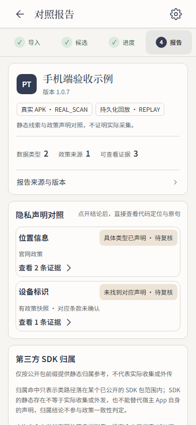

# 移动阅读设计验收

对应 #141/#144 阶段审阅 R3/R4/R5，依赖前置 #160。仅包含报告摘要、材料条和分析服务存储文案。本轮不接管 R1 政策跳转与 R2 进度请求取消的整合修复，也不关闭整个工单。

源码：`e700c8389573dba716f396254ebca9409f06dd79`，在已提交且 tracked clean 的工作树截图。后续证据提交不修改产品或测试源码。逐图视口、时间、版本和7组检查结果见 [verification.json](verification.json)。原报告、来源类型、投递方式及边界说明完整保留；统计只表示材料数量。

复现：`npm ci`、`npx playwright install chromium`、`npm run acceptance:reading`。默认输出到忽略的 `tmp/mobile-reading/`；设置 `PRIVACYTRACE_READING_EVIDENCE` 可选择输出目录。该脚本复用现有round-2夹具和原生桥，并启动、关闭自己拥有的Vite，不改外部服务。已加入 Browser Acceptance 的持续检查。

| 场景 | 实际结果 | 截图 |
| --- | --- | --- |
| 390×844 候选页 | 材料/详情/更换同一行；完整名称、服务和材料版本仍可展开 | [候选](candidates-390.png) |
| 390×844 报告 | 一次应用身份，来源/投递分列，第一条结论及证据入口完整进入首屏 | [报告](report-390.png) |
| 键盘展开详情 | 包名、原时间、分析服务与完整边界可达；保留更换材料入口且不重复上传 | [详情](report-details-390.png) |
| 远端存储 | 分析服务与设备本地模型Key说明分开，实例可见 | [设置](settings-390.png) |
| 320/768及200%字号 | 无页面横向溢出，详情内容可达 | [320](report-320.png)、[768](report-768.png)、[大字](report-390-large-text.png) |
| 1440×900 桌面 | 仍使用原桌面导入结构 | [桌面](desktop-import-1440.png) |

独立视觉、需求、代码标准审阅通过。代码标准审阅提出的持续回归建议已接入；“更换材料”作为次要操作放在报告来源详情内，首屏优先呈现证据对照。真实Android、IME、TalkBack、APK扫描及个人模型均 **NOT_RUN**；此处为 Chromium + 固定报告 + 模拟原生桥。外层导航200%字号的拥挤留待前置整合观察。
