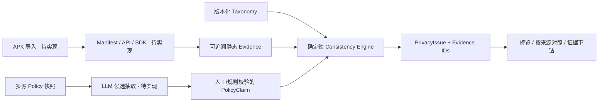

# 架构决策 ADR-001

> 后续公网服务的技术栈与执行边界提案见 [ADR-0003](adr/0003-public-api-docker-boundary.md) 和 [2026-10-16 调研方案](planning/api-docker-20261016.md)。该提案尚未实施；下文建仓方案保留原时点状态。

状态：建仓默认方案；后续变更需记录理由。日期：2026-10-02。

后端使用 Python 3.11+ / FastAPI / Pydantic，便于接入 Python APK 分析生态；前端使用 Vue 3 / TypeScript / Vite。数据库基线为 SQLite，当前只有 schema，待样本主线接入。建仓使用 uv 和 npm 锁定依赖，不引入工作流队列、RAG 或多智能体框架。

当前真实运行路径：合成 JSON → Pydantic 校验 → 规则引擎 → API → 报告页面。它验证类型契约和规则行为，不能证明 APK 分析有效性。

## 数据模型

- `PrivacyBehavior`：静态潜在数据访问或能力，引用 Manifest/API/SDK Evidence。Purpose、Recipient、Transfer、TemporalScope 先保留 UNKNOWN。
- `PolicyClaim`：独立政策源中的声明，引用对应文档的原句，不修改行为事实。
- `ContextualHint`：明确标记的推断值与依据，目前仅预留结构。
- `PolicyDocument`：来源、版本、采集时间、完整性、文本、SHA-256 和完整快照证据；政策不能拼成一个来源。
- `PrivacyIssue`：确定性状态、适用范围、行为、政策文档、Evidence IDs 与模板解释。
- `AnalysisJob`：样本、输入模式、规则版本、状态、时间与错误；当前只提供类型，不提供任务调度。

原简报第 12 页把 DECLARED_PURPOSE 放在“事实”一列，但正文强调事实/声明/推断分开。本仓库把政策声明目的存在 `PolicyClaim.declared_purpose`；代码事实中的 Purpose 保留 UNKNOWN，防止政策自述被当成程序运行事实。

## 初版规则边界

有 API 访问证据才能核验潜在访问；单独权限或 SDK 特征不足。针对每个宿主政策分别判断具体类型、上位类别、模糊候选、缺失候选或证据不足。没有候选时，只有完整快照才能输出未找到声明；此结果依赖已整理 claims 的覆盖度，仍需原文复核。

精确与类别匹配只覆盖数据类型。未来增加目的、接收方、行为、范围的独立具体性维度和版本匹配；当前不把这些字段省略当作已充分声明。跨来源冲突限不同宿主渠道的一方有声明、另一方没有声明；同一渠道的两个版本不会直接触发该规则。SDK 政策不参与宿主补声明或冲突计算，独立 SDK 核验后续实现。

输入校验：唯一 ID、引用存在、来源类型、快照哈希、原句存在、规则版本、数据类型、声明/静态证据边界。输出可沿 Evidence IDs 回到来源位置。当前规则不判断代码可达性、运行时触发、数据流或目的。

## API

| 方法 | 地址 | 当前功能 |
|---|---|---|
| GET | `/api/v1/health` | 健康检查，mode=scaffold |
| GET | `/api/v1/taxonomy` | 版本化分类体系 |
| GET | `/api/v1/demo/report` | 明确标识的合成报告 |
| GET | `/api/v1/demo/evidence/{id}` | 合成证据详情 |
| POST | `/api/v1/consistency/evaluate` | 已结构化证据的纯规则核验 |

POST 不接受 APK，不执行上传代码，也不调用模型。尚无鉴权、限流或部署配置，仅用于本机开发。最大输入列表长度由模型约束。后续公开服务前另设上传、隔离处理、作业状态、资源限制和数据删除流程。

## AI 接入约定

AI 的产品用途在 Policy Parser：切分、结构化、候选解释；规则负责最终状态。后续密钥仅放服务端环境变量，候选必须通过编号、原句、分类与来源校验；抽取失败要有可恢复状态。不得因 APK 或政策中出现指令文本而执行工具动作。

### PT-506 更新（2026-10-12）

以上建仓方案保留当时状态。PR #42 已实现默认关闭的可选政策候选抽取插件，通过 CLI 或 Python 接口启用；CLI 密钥仅从后端环境变量读取。输出经原句、分类及 `PolicyClaim` schema 校验，仍为 `UNREVIEWED` 候选，模型不决定最终核验状态。请求失败、非法 Token 统计和不合 schema 的候选不会阻塞已有人工候选保存。

启用插件时使用带哈希校验的 v2 捕获包，另存模型、提示词、规则版本及调用统计和失败代码；关闭时继续使用 v1。验证覆盖 Mock 输出和本地 HTTP 服务，未执行真实在线模型与人工真值对照实验，不能据此声称模型语义准确率或提示词注入免疫。

### PT-MOB-102 更新（2026-10-19）

PR #88 在既有证据模型上增加包集合与来源发现，不改变“静态线索不等于运行时事实”的边界：

- `/package-set` 接受 1 个 base 与至多 100 个 split（总计 150 MiB）。上传先在同一受限 worker 中解析 manifest，再校验包名/版本一致、split 名唯一、声明依赖（`uses-split`、`configForSplit`、split type）完整且无环。拒绝时保留草稿原状态、清理本次暂存文件并允许整组重试。单 APK 入口保留既有异步扫描校验边界，缺失依赖作为任务失败返回具体错误码。每个包文件的元数据检查在独立受限 worker 中执行；101 文件上限的总检查预算为 600 秒（本地实测 254 秒，保留慢 runner 余量），流式上传另有 180 秒预算。
- `/sources/discover` 只从 manifest 元数据提取候选 URL；服务端保存“发现”记录，来源出处与正文取得方式分开记录。发现 URL 不表示已取得正文，外部导入正文保留导入审计，抓取成功另记 `DIRECT_WEB_FETCH`。政策文档仍为 `UNREVIEWED` / `PARTIAL` / `NOT_CHECKED`，不自动提升复核状态。自动发现来源继承上传包的包名与 versionCode 作为适用边界；用户手工来源仍按输入，空值保持 UNKNOWN。外部导入的 `RETRIEVED` 正文以 `ready` 状态呈现，但 acquisition 仍是 `EXTERNAL_CHAT_EXPORT`，直到后端抓取替换正文。
- 远程任务增加证据下钻、失败/取消任务的 retry 血缘（`retry_of`）与删除墓碑保护；retry 只复用本服务保留的不可变输入。
- 包集合的 base 与 split 身份进入报告样本摘要并绑定扫描前后的集合摘要；worker 目录扫描与单 APK 扫描继续在相同隔离参数下执行。

这些验证使用构造的 APK/元数据与受控抓取响应，不证明第三方应用行为、政策真实性、设备可安装性或运行时采集；持久队列、专用 runner 与跨实例恢复仍属 Issue #80。
