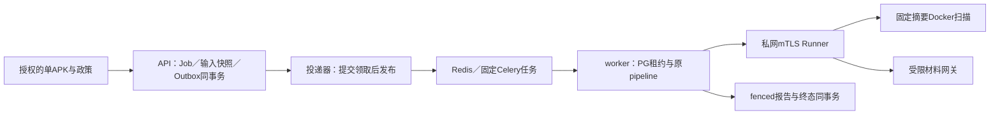

# #80 公网运行时接口与恢复说明

所有剩余实现使用 `codex/issue80-complete` 和一个最终 `Refs #80` PR。授权、实际会话、
最新main／head、文件owner和最终提交验收只维护在
[#80唯一当前执行记录](https://github.com/MrEcho114/PrivacyTrace/issues/80#issuecomment-6248982344)。
以下是当前候选接口；历史实施收据在文末原文保留。生产部署由#81交付，本票不部署。

## 运行路径与事务



复用PR#87的PostgreSQL、JobStorageProtocol和SecuritySeam；复用已合入#88的业务管线、
来源／包集合／政策状态／报告模型。[#70 owner正式交接](https://github.com/MrEcho114/PrivacyTrace/issues/80#issuecomment-6260562200)
允许本会话串行装配共享入口。没有第二套分析引擎。默认JSON／CLI和既有本机Web保持原行为。

迁移只由独立schema owner运行：`PRIVACYTRACE_MIGRATION_DATABASE_URL` 配置后，执行
`uv run --project apps/api --locked --extra worker alembic -c apps/api/alembic.ini upgrade head`。
当前schema `0080_05`，按`0080_01`至`0080_05`增量升级，不改已发布迁移。应用严格检查版本，
不自动迁移，也不持有迁移URL。新增表FORCE RLS沿用实例边界；runtime无superuser／
CREATE／BYPASSRLS，删除意图只允许SELECT／INSERT，不能清空审计、作用域或历史。

`DurableWebIntake.start()`在原登记事务中固定输入快照，并调用Outbox：Job、凭据摘要、
输入引用、事件、执行记录和审计同成同败。`PostgresOutbox.register`供可信内部登记使用；
已有业务事务使用`enqueue`，唯一约束保证同Job／类型／版本一个事件。不从未提交事务发布。
没有APK材料的旧通用`POST /api/v1/jobs`在durable模式明确返回409 `APK_INTAKE_REQUIRED`，
使用原草稿→上传→start路径。默认本机模式的通用登记契约保持。

唯一消息版本为以下五字段JSON；不允许扩展键、重复键、未知版本、命令、路径或凭据：

```json
{"version":1,"event_type":"privacytrace.job.ready","instance_id":"00000000-0000-0000-0000-000000000001","job_id":"server-generated-job-id","event_id":"00000000-0000-0000-0000-000000000002"}
```

`claim`在短事务内使用DB时间、SKIP LOCKED和随机claim token，限制1–100条、1–300秒。
先提交，再发布，再独立ack；失败只记固定代码及退避，最多五次领取。发布后ack丢失可以
重复投递。API进程、Redis内存或RPC缓存均不是任务权威。

worker只注册`privacytrace.execute.v1`，固定JSON、无结果backend／remote-control／自动
未知队列，拒绝canvas及任务ID不匹配。PG execution最多三次，owner UUID和递增fence、
默认60秒租约、最长300秒尝试，续租用DB时间。过期／断连恢复沿用同Job和事件，错误标明
`INTERNAL_RETRY`，不重置预算。用户retry是带`retry_of`的新Job。报告与SUCCEEDED／摘要／
审计原子提交，同owner及相同结果重复提交只读；取消／删除与撤销、fence递增同事务。
OOM、超时、畸形输出有限终态失败。恢复器重投300秒未领取事件，耗尽预算留下可查询失败。

## 供#81消费的进程与配置

安装依赖使用`uv sync --project apps/api --locked --extra worker --extra runtime`。
以下命令均在同一代码版本运行，不把密码放CLI参数或日志；环境由各进程最小权限注入。

| 进程 | Python模块／入口 | 必需配置与隔离 |
| --- | --- | --- |
| 公网API | `uvicorn privacytrace.main:app` | STORAGE=postgres、MODE=remote、EXECUTION=durable、DATABASE_URL、INSTANCE_ID、STORE_ROOT及下列control身份；无需broker权限，无Docker socket |
| 投递器／恢复器 | `python -m privacytrace.queue_runtime`（可`--once`） | PG runtime、实例、材料根、BROKER_URL；无需材料签名／TLS私钥，无Docker socket |
| 编排worker | `python -m privacytrace.runtime_worker` | PG runtime、实例／材料根、broker及control身份；无Docker socket，不解析APK |
| 材料网关 | `python -m privacytrace.material_gateway` | PG runtime、实例／材料根、MATERIAL_KEY_FILE、GATEWAY_BIND／PORT／TLS_*／PEERS；独立私网监听 |
| 专用Runner | `python -m privacytrace.runner_service` | 实例、RUNNER_ROOT／IMAGE_ID／BIND／PORT／TIMEOUT／TLS_*／PEERS、GATEWAY_URL、RUNNER_GATEWAY_TLS_*；专用Linux主机或VM，仅本机固定Unix socket |
| 回收器 | `python -m privacytrace.material_lifecycle`（可`--once`） | PG runtime、实例／材料根；每30秒回收，不持有broker或删除签名密钥 |

表中所有大写名称均有`PRIVACYTRACE_`前缀。control身份指`MATERIAL_KEY_FILE`（私有32字节）、
`RUNNER_URL`（固定私网HTTPS字面IP）、`RUNNER_IMAGE_ID`（固定`sha256:`镜像ID）和
`CONTROL_TLS_CA/CERT/KEY`。`TLS_*`统一为`CA/CERT/KEY`；`PEERS`是允许的DER证书SHA256
指纹列表。CA、IP／主机名验证、TLS1.3和服务端角色指纹同时适用。禁止代理继承和重定向。
Runner没有PG／broker／材料签名密钥，APK容器没有任何这些凭据。

API／worker启动拒绝可访问的本机socket和Docker endpoint环境；部署须同时移除挂载／
Docker组／特权及宿主根挂载，Windows普通用户控制面在真实测试中没有socket能力。
Runner使用固定本机`unix:///var/run/docker.sock`，不透传Docker API。固定镜像在启动前
由运维预装并解析摘要，不由请求选择；rootless socket兼容不在本轮声明中。

Redis要求认证、实例key及channel前缀ACL、AOF、容量和`noeviction`。队列为
`privacytrace.<instance_uuid>`，key前缀`pt80:<instance_uuid>:`。应用所需前缀内读写、
事务、pubsub和Lua不得扩大为ACL／CONFIG／全库清理权限。`rediss`校验证书及主机名。
runtime代码不替代这些部署配置；#81应使用独立服务身份和私网规则装配。

## Runner与材料边界

Runner协议版本1固定operation／request／instance／scope／owner／fence／package_set／
files。文件仅含受限name、摘要、长度、短期ticket；没有镜像、shell、宿主路径、daemon或
下载URL。ticket最多300秒，绑定任务／草稿、owner和fence；网关及Runner运行许可每次
检查PG，流传输中重复检查。输入复制到Runner私有目录，绝不绑定API材料卷给容器。

沿用既有isolated_scan：无网络、只读根、65534:65534、cap-drop ALL、no-new-privileges、
private cgroup、1GiB内存及无额外swap、1CPU、32 pids、有限tmpfs与180秒内超时。
实际inspect核对完整限制、唯一只读输入挂载；正常退出另检查OOMKilled／ExitCode。
报告的脱敏`runner_receipt`记录实际限制及清理，宿主路径换成`runner:<request_id>`。
本轮实际Docker OOM收据为OOMKilled=true、ExitCode137。静态线索仍只代表潜在行为。

Runner独占根目录，SQLite只保留有限RPC缓存（128条／32MiB／360秒），不替代PG账本。
服务循环每30秒回收已到期的非运行记录，启用SQLite secure_delete，并在接收前再次回收；
空闲时也执行。回收失败停止接收。该逻辑不声明擦除文件系统或离线副本中的所有残留。
崩溃后只清理本账本中的UUID操作、精确容器名／label／镜像／只读输入挂载；归属未知
保留现场并拒绝复用。清理完成后才释放磁盘预算，不执行全局prune。

持久根目录官方材料保留至明确删除，不使用短期TTL。当前上限：12个草稿、1000活动Job、
4GiB私有材料、16MiB剩余空间底线、单APK／包集合总量150MiB，另有不可变JSON对象数量／
大小及历史quota。上传使用900秒PG保留、随机owner临时文件、发布前后校验；并发API不能
凭mtime删除别人的在途上传。容量满或ENOSPC拒绝新登记，数据库指针不能指向未写完的对象。

Job删除撤销该Job并清理其快照／报告；共享Draft输入仍按独立权限保留。
授权`DELETE /api/v1/web/drafts/{draft_id}`显式删除Draft材料及其关联Job。回收先提交
指针删除，再重新核对无引用后删文件，保留其他作用域和全局模型配置。未知临时文件不盲删。
撤销先于物理回收；文件占用或I/O错误留下pending，回收器重试。迟到结果无提交资格。

新旧调度切换必须先停止旧owner，实际取得原`service.lock`后才建立持久模式标记；
普通API重启不占全局单进程锁。旧调度见标记拒绝启动。旧无execution的活动任务标记
`SERVICE_INTERRUPTED`，仅显式新任务retry；已有持久任务不受影响。不自动删除模式标记降级。

## 一致备份、恢复与显式JSON导入

备份前停止新接收并等待运行中执行／上传结束；队列中的READY任务可保留。
`python -m privacytrace.runtime_backup backup <新备份文件>`在实例事务锁下固定数据库
及材料清单，以同一快照输出白名单表、摘要和全部引用材料。备份有大小上限、版本及HMAC，
私有0600、fsync、发布不覆盖。无可执行归档条目。全局模型Key、数据库URL、TLS私钥、
短期ticket和上传保留不入备份；配置及私钥由运维另外恢复。

`DELETION_JOURNAL_ROOT`必须是备份回滚范围之外的独立耐久位置；默认在实例目录外。
每次删除先fsync HMAC链式意图，再提交PG撤销。数据库保留只追加检查点；新接收留足
删除日志容量。最新日志和签名密钥必须另外保全，不能用旧备份中的日志替换它们。
不完整未确认尾部先保留再修复；缺失已提交历史或认证失败会拒绝恢复。

将同一实例UUID、签名密钥与最新删除日志配置到**新的空目标数据库和空材料根**，先由
迁移角色升级schema，再用受限runtime运行：
`python -m privacytrace.runtime_backup restore <备份文件>`。
验证所有材料摘要后导入，在同一事务内失效旧执行owner／递增fence并重放最新删除意图，
然后完成GC再开放访问。RPC幂等标识含owner，数值fence回退也不能命中旧缓存。
不允许覆盖一个仍在使用的实例。

工具在FORCE RLS下核验目标实例为空，不能枚举或擦除其他实例；新空数据库由运维明确
配置。真实恢复测试使用来源之外的第二个可丢弃库，每例使用新的独立实例namespace。

恢复门禁`.restore-in-progress`阻止普通连接访问同一实例根；COMMIT不确定或清理失败时
保留门禁和已认证所有权，使用同一备份加`--resume`续跑。真实PG提交审计区分“全回滚”
和“已提交待清理”，防止重复导入；认证通过的临时目录才可回收，未知目标数据保留检查。
备份RPO之后的新材料不可能由旧快照恢复。最新删除意图即使原DB提交失败也保守重放。
Linux文件／目录fsync已实跑；Windows文件fsync保留，未声称Windows断电演练。

部署约定备份保留窗口最多7天，周期／副本由#81运维配置并监控到期回收；本工具创建的
备份不会自行后台过期。备份是私有敏感材料，主动删除后旧副本在保留窗口内仍可能存在，
恢复必须携带最新独立删除日志，不能声称立即擦除所有离线副本。

JSON导入是明确的离线操作：`python -m privacytrace.runtime_import <JSON根> <job_id...>
--mapping <新的私有映射文件>`。只接受终态记录，批次有上限，生成新ID／新凭据并同步
bundle身份；保留原JSON字节、证据／政策／备注和来源，不升级真实性。旧token不获得新
作用域权限，工具路径不被打开／执行；不导入APK、活动任务或调度。凭据只写独立0600
映射，不输出stdout；提交不确定时按映射ID／摘要读回，不能靠重试覆盖旧凭据文件。

## 验证入口及当前收据

权威入口仍是原样`bash scripts/check.sh`，Windows委托`pwsh -NoProfile -File scripts/check.ps1`。
独立联合专项`bash scripts/check-runtime.sh`要求两套不同`*_test`数据库的runtime／migration
URL、真实redis-server及runtime extra；不同角色由真实测试再次校验。Runner opt-in为
`PRIVACYTRACE_RUNNER_TESTS=1`和`PRIVACYTRACE_DOCKER_TESTS=1`，真实小tmpfs磁盘满专项
需专用Linux root测试环境及`PRIVACYTRACE_ENOSPC_TESTS=1`。未提供的边界明确skip。

Windows端到端入口`pwsh -NoProfile -File scripts/check-runtime-e2e.ps1`要求已授权的独立
WSL VM标记／入口、真实PG和runtime extra，不安装系统、不使用共享broker。普通用户
API／Celery进程和VM Redis／Runner真实通信，材料不通过共享挂载传输。

当前实施收据（均为2026-10-19候选源码哈希；最终交付SHA须另行复验）：

| 类别 | 实跑结果／证据 | 限制 |
| --- | --- | --- |
| PostgreSQL＋Redis | 150 passed，`runtime-lease.log` | 非完整APK链路；部分期限边界用SQL置过期，另有真实进程退出用例 |
| 真实PG／协议／TLS回归 | 75 passed，`materials-20261019T125831Z.*` | 注册夹具不解析APK，TLS实际握手 |
| PG＋mTLS＋专用Docker Runner | 10 passed，新`runner-lease.log` | 合成二进制APK实际解析；OOM／timeout等受控镜像不分析APK |
| 真PG＋文件系统／ENOSPC | 20 passed，`recovery-lease.log` | 独立8MiB tmpfs，不模拟主机物理断电 |
| 追加恢复／导入 | 12 passed，`backup-20261019T130323Z.*` | 含真实COMMIT拒绝；提交后清理故障在文件系统接口注入，非进程kill |
| 系统端到端 | 4 passed，`e2e-20261019T130119Z.*` | 真实API／broker／worker／Runner进程重启、授权／取消／删除；不是公网部署 |
| 先前完整权威检查 | API1602 passed／29 skipped、Web53，`authority-lease-20261019T082759Z.log` | 绑定先前候选，不能证明后续恢复代码；跳过分类保留于执行记录 |

mock、协议单测、实际组件、系统端到端和未执行项分别计数。最终PR必须附最新权威／
组件／系统结果、完整diff审查及确切远端head的检查结果，不能复用旧SHA绿灯。

收尾后追加的联合专项为**230 passed／0 skipped**；恢复组合为**22 passed**，含大材料、
受控base/input硬链接及真实ENOSPC。系统专项为**5 passed**（`e2e-20261019T132400Z.*`），
新增两个实例、两套队列／Runner并发实际扫描与交叉拒绝。更新后的完整权威入口曾通过
**1643 passed／17 skipped、Web53**；随后收尾须再绑定最终提交验证。可复核的脱敏命令
输出、原始／脱敏摘要和候选源码LF摘要见[验证索引](evidence/issue80/README.md)及
[机器可读清单](evidence/issue80/validation.json)。未向仓库提交私有材料或原始带私有路径日志。

## 历史实施记录（原文保留）

<details>
<summary>早期技术顺序和当时验收／未完成状态，不能当作当前接口状态</summary>

# #80 公网运行时实现与整体验收

统一分支为 `codex/issue80-complete`；全部剩余实现累积到一个最终 PR，使用 `Refs #80`。
唯一当前授权、会话、实际 head、测试证据及共享归属见
[#80 当前执行记录](https://github.com/MrEcho114/PrivacyTrace/issues/80#issuecomment-6248982344)。
PR #87 已合入的 PostgreSQL 适配、JobStorageProtocol、SecuritySeam 和业务模型继续复用。
本文中的功能说明不代表 #80 整票验收完成。

## 已实现的 Outbox 基础层

`PostgresOutbox(store).register(job, token_digest)` 在同一个 PostgreSQL 连接／事务中调用
既有 `create_if_absent` 并登记待投递事件。调用方已有外层事务时复用该事务，只有外层提交
后才能被其他连接看到；失败时 Job、凭据摘要、审计和事件全部回滚。它是受信任的内部存储
接口，调用者仍须先经过现有 HTTP 作用域／动作授权，不增加新的公开端点。

已有业务事务也可在创建 Job 后显式调用 `enqueue(job_id)`；重复调用返回同一事件。
`register` 复用原有重复 Job ID 拒绝语义，不覆盖已有 Job。现有 JSON、CLI 和 HTTP 创建
路径不会隐式产生事件；本轮没有切换 WebIntake 或接入执行器。

Alembic `0080_02` 从 `0080_01` 增量创建 `outbox_events`，不改原迁移或公共语义模型。
该表采用实例／事件复合主键、实例／Job 外键以及
`(instance_id, job_id, event_type, version)` 唯一约束；事件 UUID 是消息幂等标识。
存储启动继续严格验证迁移版本，API 不自动升级或读取迁移凭据。部署升级须协调代码与
迁移版本，旧代码不被冒称能够读取新 schema。显式 downgrade 会删除 Outbox 事件，不能
用作恢复或重投方案；迁移回退检查仅在可丢弃测试库执行。

## 固定消息协议

唯一可接受的 JSON 字段如下，不支持扩展键、重复 JSON 键、任意任务名或反序列化代码：

```json
{
  "version": 1,
  "event_type": "privacytrace.job.ready",
  "instance_id": "00000000-0000-0000-0000-000000000001",
  "job_id": "server-generated-job-id",
  "event_id": "00000000-0000-0000-0000-000000000002"
}
```

`decode_message` 检查全部字段、规范 UUID、既有 Job ID 格式、整数版本及输入长度。
事件表没有可携带任意业务 JSON 的 payload 列。消息不含 APK、政策正文、访问凭据、
宿主路径、镜像、shell、daemon 地址或下载 URL；解析失败不回显收到的材料。

## 领取、确认、失败及恢复边界

- `claim(limit=10, visibility_seconds=30)`：数量 1–100，可见性期限 1–300 秒。短事务内
  按待投递时间和事件 ID 排序，使用 `FOR UPDATE SKIP LOCKED`，写入随机领取 token、
  服务端时间计算的截止时间及递增尝试次数，然后提交。复用既有每实例事务 advisory lock
  维持存储修改串行语义；它不是执行租约，不能当作扫描的分布式排他保证。
- 领取、确认和失败记录必须各自拥有独立事务。若在调用方未提交的事务内调用这些投递
  接口会直接拒绝，防止从随后回滚的任务登记中提前取走消息。
- 投递器在领取事务提交后执行网络发布；成功后以事件 ID 和领取 token 调用
  `acknowledge`。发布不能放在数据库事务里。确认仅接受当前未到期 owner，重复确认、
  旧 token、过期 token 或其他实例返回失败，不改变新 owner 的记录。
- `fail` 只接受 `BROKER_UNAVAILABLE`、`DELIVERY_REJECTED`、`DELIVERY_TIMEOUT`
  三个固定错误码；重试延迟 0–3600 秒，不保存任意异常文本。最多领取五次，失败或领取
  崩溃耗尽预算后进入可查询的 `FAILED`，不无限循环，也不以重复 enqueue 重置预算。
- 领取者崩溃后，截止时间到达可再次领取同一事件并更换 token。发布成功但数据库确认
  丢失可能导致重复消息，故这里只保证至少一次发布尝试；后续消费者仍须数据库 lease／
  fencing、幂等提交和取消检查。本轮没有声称实现消息 exactly-once 或可靠执行。
- 所有领取／确认／失败操作复查 Job：只允许当前实例中未 tombstone 的 `QUEUED` Job。
  取消、删除或其他终态的未完成事件变为 `DISCARDED`，不恢复 Job 或凭据。已发布到
  broker 的消息无法撤回，最终消费者仍必须在获取租约及提交结果时检查撤销状态。
- Outbox 启用 FORCE RLS，复用事务局部实例上下文。runtime 只有 SELECT／INSERT／UPDATE，
  没有 DELETE／TRUNCATE／DDL；没有公开事件枚举接口，也不改原权限与实例边界。

## 真实 PostgreSQL 验证

使用独立、可丢弃且以 `_test` 结尾的数据库，提供不同 runtime／migration LOGIN。
专项包含显式降级、重建与真实 COMMIT 拒绝，不能指向业务数据库。通用入口：

```sh
uv run --project apps/api --locked --extra worker python -B -m pytest \
  apps/api/tests/test_postgres_storage.py apps/api/tests/test_postgres_outbox.py \
  apps/api/tests/test_storage_selection.py -q -p no:cacheprovider --tb=short -ra
```

Windows 单命令入口 `pwsh -NoProfile -File scripts/check-postgres.ps1` 缺任一数据库 URL
会失败；普通 pytest 无 URL 时明确跳过数据库用例。协议检查不访问数据库，单列统计。
测试验证原子提交／回滚、服务端延迟外键在真实 COMMIT 返回 23503、提交前不可见、
并发登记／重复 enqueue、独立连接领取和被锁行跳过、领取崩溃恢复、过期 token 拒绝、
有限重试、取消／删除、跨实例、RLS／权限、增量迁移／漂移及独立进程读取。
部分截止时间测试通过真实 SQL 将已存截止时间置为过去，验证到期分支，不模拟数据库。
另有领取子进程 `os._exit(17)` 后等待真实可见性期限的恢复用例，未替换数据库或时钟。

2026-10-18 本机候选验证使用原生 PostgreSQL 17.9 的独立新集群、可丢弃测试库及不同
runtime／migration LOGIN，未复用或清空旧测试库。联合专项 **105 passed / 0 skipped**：
76 项真实 PostgreSQL（既有 51 + Outbox 25）、7 项 JSON、5 项配置、17 项纯消息协议。
Outbox 文件合计 42 项，协议用例不冒称访问了数据库。三项独立投递事务回归先失败，
修复后通过，禁止从未提交外层事务领取或确认。真实 COMMIT 拒绝的 SQLSTATE 为 23503，
跨实例写入及权限拒绝另确认 42501，不把其他约束错误误当 RLS 证据。
Windows 数据库专项入口另实跑 **100 passed / 0 skipped**，不包含联合专项的 5 项配置检查。

实际正常 fast 重启本轮专用 PostgreSQL postmaster，确认启动时间改变、Job／事件与
领取状态保留，超时后同一事件可再次领取、旧 token 确认被拒绝。此证据不代表掉电、
broker 故障、Runner 扫描或数据库与材料备份恢复。

当前代码的权威入口实际结果为 **1145 passed / 20 skipped / 1 failed**。唯一失败是未改动
的 `test_cache_writer_does_not_follow_directory_symlink_or_corrupt_parallel` 在创建目录
符号链接时遇到 Windows WinError 1314，发生在产品代码执行前。未排除、弱化该用例或
修改系统权限；最后一次执行仅附加 `-ra`／JUnit 报告选项，没有筛选或重试。20 项跳过
为 11 项 Docker opt-in 和 9 项缺少新鲜受控构建产物，均未冒称真实扫描已验收。
权威入口在 pytest 失败处终止；其后 Ruff、迁移 Ruff、准备包、契约零差异、前端 46 项、
类型检查及生产构建已另行执行并通过，不能据此把原样入口改报为全绿。

## 共享 owner 的接口交接需求

PR #88 已合入 `e2313e19cd9e43b30aad2044ccf6624e929511cd`。
#70 owner 的[正式交接](https://github.com/MrEcho114/PrivacyTrace/issues/80#issuecomment-6260562200)
将已合入的包集合、来源与任务产物交给 #80 继续真实运行时整合，#70 已按用户授权关闭。
共享装配由本会话在唯一执行记录登记具体文件后串行接入，复用既有语义和同一管线。
以下接口仍待实施，不能据交接记录称其已完成：

1. 在现有授权后的 Job／草稿登记事务内调用 `enqueue`，同时选择持久调度模式；该模式
   不再重复调用进程内 `executor.submit`。默认本机模式保持原行为。不能只附加一条消息
   而保留双重执行路径。
2. 将持久模式的 API 启动恢复与进程内线程恢复分开，避免 API 重启把别的执行器任务标为
   `SERVICE_INTERRUPTED`。任务取消、删除和显式新任务重试继续保留原业务语义。
3. 为既有 pipeline 提供经过 owner 审查的扫描执行接缝，让编排 worker 调用固定 Runner
   客户端；默认本机仍调用既有 `scan_isolated`，不复制分析／政策／报告引擎。
4. 后续领取执行租约、带 fencing 的状态／报告提交，以及取消／删除的撤销检查，由相同
   事务边界串行接入。Outbox 的领取 token 不能替代执行 fencing。

## 整票仍未完成的工作

材料 GC／容量及磁盘满处理、数据库与材料
一致备份恢复和删除重放，以及真实单 APK 全链路和故障端到端仍待实施／验收。
PR #91 的 `scripts/check.sh` 及 #81 的生产 Compose／CI 不在本次编辑范围。
上述工作继续使用同一任务分支和一个最终 PR，不以 Outbox 通过替代整票交付。

## 已实现的受限 Celery／Redis 发布

可选依赖 `runtime` 固定 Celery 5.6.3，并由 uv.lock 锁定 Kombu／redis-py；既有
`worker` 和默认 JSON／CLI 不因此隐式加载 broker。`queue_runtime.BrokerConfig` 只接受
带 username／password 的 Redis URL、规范实例 UUID 和有界 visibility timeout；拒绝
任意 transport、查询参数和无认证配置，repr 不显示 URL。`rediss` 要求验证证书和主机名。

`CeleryPublisher` 仅发布 `privacytrace.execute.v1`，正文为一个经过既有 `decode_message`
校验的五字段事件。实例队列和 Redis key prefix 由实例 UUID 推导；固定 JSON、无结果
backend、无远程控制和自动未知队列，不在 broker 保存 APK、政策、能力凭据或命令。
Celery 自带的投递头不代表允许任意任务。当前没有启动执行消费者，不能将发布器称为
已完成的可靠执行或任务白名单消费边界。

`OutboxDispatcher.once()` 先提交短领取事务，再访问网络，最后独立确认；broker 失败
只记录固定错误码和有界退避，沿用五次领取上限。发布后确认丢失仍可能产生两条同 ID
消息，必须由后续数据库 lease／fencing 防止重复执行及重复结果。一次投递的计数不含材料。
显式选择下文的 durable 模式后，API 使用事务登记，原本机线程路径保持默认兼容。

运行投递器使用 `uv run --project apps/api --locked --extra runtime python -m
privacytrace.queue_runtime`；可加 `--once`。配置来自已有 PostgreSQL runtime URL／实例和
`PRIVACYTRACE_BROKER_URL`，不用 CLI 参数传密码，不将迁移凭据交给投递器。
Redis 运维须设置认证、AOF、容量和 noeviction，并按实例 key／channel 前缀授权。
Kombu 还需要受前缀约束的读写、事务与 Lua 操作；不授予应用 CONFIG、ACL 或全库清理权限。
这些部署配置仍由 #81 消费运行时接口后交付，本票不创建生产 Compose。

真实联合专项入口为 `bash scripts/check-runtime.sh`，要求显式可丢弃 PostgreSQL runtime／
migration URL、真实 redis-server 和 runtime extra；每例使用私有临时目录、随机认证、
独立 Redis 进程与应用／管理 ACL，不连接共享 broker、不 FLUSHDB／FLUSHALL。
2026-10-19 实跑 **121 passed / 0 skipped**：既有100项存储／Outbox，加11项真实
PostgreSQL／Redis组件用例及10项纯配置协议。覆盖真实断连及恢复、AOF重启保留、
并发投递、取消／删除、未提交事务拒绝、实例ACL和管理命令拒绝。初次真实测试发现
测试应用角色缺 MULTI／EXEC 权限，纠正后仍验证跨实例与管理拒绝；未用 Mock 替代。
省略确认／SQL置过期的用例模拟确认丢失边界，不能冒称杀死投递器进程的故障演练。

## 本机 Linux／Docker 验证环境

用户授权的 WSL2 3.0.3、任务专属 Ubuntu24.04.5 VM、Docker Engine29.9.1 已实装。
Engine smoke 使用已解析摘要的 hello-world，并保存实际 inspect；这不代表Runner验收。
此前 Windows WinError1314 和无Docker失败均保留原收据。Linux通过Git bundle取得精确
`4bc826f84b18a8fc8fc28dd4e8075aa8973eb771` 的 detached 验证副本，原样启用真实Docker的
权威检查 exit0：**1442 passed / 86 skipped**，Web53项及构建通过。该次未配置数据库，
跳过为76项PostgreSQL、9项新鲜受控构建、1项仅Windows路径预检；不冒称数据库验收。
后续新代码须使用自己的 head／文件哈希和新验证，不能复用这次环境基线结果。

## 数据库执行资格与内部恢复

增量迁移 `0080_03` 新增 `job_executions`，复用实例事务锁、限制角色及 FORCE RLS。
登记 Job／Outbox 时同时建立 READY 执行记录；旧事件只在当前实例内补齐记录，不以
迁移身份跨实例读取材料。消息须匹配已登记且已领取的事件，才可获取执行资格。
每次领取增加 attempt 和 fencing，最多三次执行；owner 是服务器生成 UUID。
默认租约60秒、单次硬截止300秒，续租使用数据库时间且不能越过硬截止。

`FencedJobStore` 只向原 pipeline 提供所需读写。每次阶段更新与结果提交都在同一个
短事务内验证 owner／fence／attempt／事件、未过期租约、未删除且非终态 Job。
报告与 SUCCEEDED、结果摘要和审计一并提交；同 token／相同完整结果重放只读，其他
结果拒绝覆盖。`LeaseLost` 让过期 worker 立即退出原管线错误保存路径。
取消／tombstone 与撤销租约、递增 fence 原子提交，迟到结果不能复活材料。

过期执行及受控基础设施失败保留同一 Job、记录 `INTERNAL_RETRY`，重投原事件；
执行最多三次、事件总领取仍最多五次，不因恢复重置预算。已投递但未领取的事件在
300秒后可重新投递，预算耗尽形成可查询 FAILED。数据库恢复会筛选真正需要恢复的
记录，待投递积压不会挡住过期租约。OOM／扫描输入／管线错误为有限终态失败；
用户显式 retry 仍由既有 API 创建带 retry_of 的新 Job，不计作内部恢复。

2026-10-19 真实 PostgreSQL 执行专项 **29 passed**；联同存储／Outbox／真实 Redis
发布专项 **150 passed / 0 skipped**。包含独立连接竞争、取消／删除与提交竞争、
服务端延迟外键真实 COMMIT 拒绝、相同结果幂等、旧 fence 拒写、权限／迁移无漂移，
以及独立 worker 进程直接退出后等待真实租约到期恢复。受控报告契约夹具不代表 APK
扫描；部分预算边界使用 SQL 置过期，与真实进程退出用例分列。证据文件
`execution-20261019T070207Z.log/.json/.xml`、`runtime-lease.log` 绑定本轮源码哈希。
这些数据库接口尚待持续接入实际消费者／Runner，不能代替完整端到端。

前一队列候选另通过原样真实 PostgreSQL＋Docker权威检查：**1528 passed / 21 skipped**、
Web53项；21项为单独运行的11个Redis专项、9个新鲜受控产物缺失和1个Windows预检。
该收据 `authority-queue.log` 对应队列候选源哈希，未拿它证明后加租约代码已全仓通过。

## 实际消费者、材料网关与专用扫描服务

`PRIVACYTRACE_EXECUTION=durable` 明确选择 PostgreSQL 运行时；API 不提交本机分析线程，
重启和关闭不替其他worker终止任务。`DurableWebIntake` 复用原登记、政策与包集合逻辑，
同事务保存不可变运行输入、Job、Outbox和执行记录。worker复用同一pipeline及结果模型。
本机 JSON／CLI 和未选择 durable 的既有路径保持原行为，不自动迁移私有数据。

入口为 `python -m privacytrace.queue_runtime`、`privacytrace.runtime_worker`、
`privacytrace.material_gateway` 和专用主机上的 `privacytrace.runner_service`。
控制面要求显式 `PRIVACYTRACE_STORE_ROOT`；API／worker拒绝可访问的本机Docker socket及
Docker endpoint环境配置。API无需broker凭据；dispatcher无需材料签名／客户端身份密钥。
worker仅注册固定 `privacytrace.execute.v1`，校验任务ID、五字段JSON并拒绝嵌入canvas，
无结果backend／远程控制。租约续期独立于扫描，迟到结果必须通过fenced store。

网关是单独的私网mTLS监听器，没有安装到公开API路由。材料凭据绑定实例、任务／草稿、
owner、fence、摘要引用及300秒时效，每次读取与运行许可都检查数据库。Runner仅凭单次
受限凭据从固定网关取材料，不接受下载URL。TLS验证CA、主机IP及明确的角色证书指纹，
禁止代理环境继承和重定向；Runner没有数据库、迁移或材料签名密钥。

Runner启动时固定 `sha256:` 镜像ID、操作和容器参数；RPC不接受镜像、命令、宿主路径
或Docker endpoint。它调用既有isolated_scan，保留实际inspect、无网络、只读根、非root、
能力／资源限制及清理收据；报告只携带脱敏收据和 `runner:<id>` 定位。私有SQLite只存
短期RPC幂等缓存，不作为任务账本。重启只检查本服务账本中的工作目录、精确label／
镜像／挂载后回收孤儿，不能全局prune；未证明清理完成时暂停接收并保留预算。

2026-10-19真实Runner组件 **6 passed**：既有构建器产生的合成二进制APK确实通过
mTLS／PostgreSQL进入固定Docker扫描器；另列受控故障镜像的timeout／畸形输出清理，
不称这两项进行了APK分析。证据 `runner-lease.log`、`runner-component.xml`。

首条真实系统E2E **1 passed**，证据 `e2e-20261019T080148Z.log/.json/.xml`：普通用户
Windows API／Celery进程，真实PG、VM Redis、专用WSL2 Runner、无共享材料挂载，经过
API进程终止／重启、投递、租约、实际Docker、原pipeline与授权报告读取。
协议检查、mTLS／PG材料与登记等另有74项，不能都称端到端。Windows专用入口
`pwsh -NoProfile -File scripts/check-runtime-e2e.ps1` 要求显式独立测试库及既有授权VM标记；
它不安装系统或复用共享broker。完整故障矩阵、材料删除与一致恢复仍在持续补齐。

</details>
