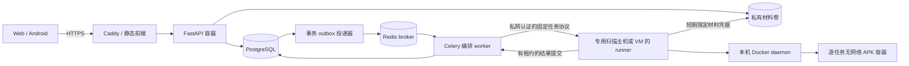

# 公网 API 容器化：可行性与实施方案

日期：2026-10-16。核查基线：`58bcdd9db1ac6c6fa5efad928a1df44c584f22c7`。

用户已选择**公网多用户服务**；本轮交付调研、技术栈方案及未完成 Issues 更新，实施另按工单启动。本方案是后续目标，不表示容器化、远程访问保护或公网环境已经可用。沿用 #68 的无账号、免登录、任务级访问保护、个人模型 Key 只留手机及材料长期保留约定。

## 结论与现状

可行，且无需重写前后端或静态分析引擎。真正需要改变的是部署、存储、调度和权限边界。公网匿名用户之间以独立任务隔离，不引入账号体系；这不提供可准确识别“每个人”的配额。

| 核查项 | main 中的实际状态 | 公网目标 |
| --- | --- | --- |
| 前端 | Vue 3 / TypeScript / Vite；同源 `/api`；Vite 代理用于开发 | 生产构建由 HTTPS 入口提供，Android 保留 Tauri 2 / Kotlin 桥接路线 |
| API | Python 3.11–3.13 / FastAPI / Pydantic；Host、Origin、Local header 限本机 | Python 3.12 基础镜像、uv 锁定依赖、Uvicorn；独立 remote 模式及端点授权矩阵 |
| Web 输入 | #57 已合并，上传、政策、候选、任务、报告可复用 | 适配远程访问和安装包集合，复用原 pipeline |
| 作业 | JSON JobStore、文件锁；WebIntake 单进程 service.lock、两条线程 | PostgreSQL 作状态权威，Celery + Redis 作持久投递，独立执行和恢复 |
| 重启 | 非终态变为 `FAILED / SERVICE_INTERRUPTED`，显式重试建新任务 | 区分内部投递恢复和用户新任务重试；租约、幂等、取消和提交防重 |
| 扫描 | Androguard 4.1.3；只有 worker.Dockerfile，固定本机 Docker socket、单 APK bind mount | API 与编排 worker 无 socket；专用扫描主机或 VM 上的可信 runner 启动隔离容器 |
| 配置与材料 | 本机 JSON/草稿目录、实例级 model.json；无任务间远程访问保护 | 私有持久卷、数据库权限映射、受保护运维配置、删除及容量守卫 |

代码依据：[main.py](../../apps/api/src/privacytrace/main.py)、[web_api.py](../../apps/api/src/privacytrace/web_api.py)、[web_intake.py](../../apps/api/src/privacytrace/web_intake.py)、[job_store.py](../../apps/api/src/privacytrace/job_store.py)、[isolated_scan.py](../../apps/api/src/privacytrace/isolated_scan.py)、[worker.Dockerfile](../../apps/api/worker.Dockerfile)、[.dockerignore](../../.dockerignore)。本机防护不是公网身份验证；改变监听地址不能完成迁移。API 进程内路径也不天然等于 Docker daemon 主机路径。[Docker bind mounts](https://docs.docker.com/engine/storage/bind-mounts/)

## 方案比较

| 方案 | 优点 | 代价与结论 |
| --- | --- | --- |
| API 容器 + JSON 卷 + 宿主 socket | 改动最少 | 公网入口具有 daemon 控制能力，仍有单进程锁和恢复限制；不作为公网方案 |
| Compose + PostgreSQL + Celery/Redis + 专用扫描主机/VM | 复用 Python 生态；HTTP、持久状态与不可信 APK 处理分开；可逐票验收 | 新增数据库、队列、runner 和备份运维；推荐基线 |
| PostgreSQL `SKIP LOCKED` 直接实现任务队列 | 少一个 broker | 还需自行维护投递、租约、重试、取消与观测；保留备选，不同时实现两套调度；[官方 SELECT 说明](https://www.postgresql.org/docs/current/sql-select.html) |
| Kubernetes / 多区服务 | 便于后续编排扩容 | 当前无容量证据支持其成本；首版延期，不作为公网服务前置条件 |

Docker 官方将 daemon 控制权视为高权限边界，控制者可以挂载宿主文件系统。socket 即使以只读挂载也不等于只读 Docker API，普通 socket proxy 也不自动验证镜像、路径和容器参数。本项目因此把 daemon 留在专用扫描主机/VM，公网 API、政策编排进程与 APK 容器均无该权限。[Docker 安全说明](https://docs.docker.com/engine/security/)

## 目标拓扑与技术栈

图中材料卷由受保护的内部传输端点读取，不向 runner 暴露宿主共享目录，也不把整个卷挂进 APK 容器。公网业务入口和 runner 内部入口分别鉴权；数据库、broker、runner、Caddy 管理端口均不公开。

控制面使用 Docker Compose，首版一个 API 容器、一个编排 worker、一个 outbox 投递器，数据库与 broker 使用私有网络和持久卷。扫描面单独主机/VM；相同物理机上的专用 VM 可用于初期部署。Compose 自身不是跨主机调度器，扫描面由独立部署清单管理。默认扫描并发从 1 起测，再据实测调整；没有吞吐、费用或可用性承诺。

FastAPI 官方支持自建 Python 镜像与 Uvicorn；本方案先使用一个进程/容器，待单进程 WebIntake 限制拆除并通过共享状态测试后再扩副本。[FastAPI Docker](https://fastapi.tiangolo.com/deployment/docker/)。镜像用 uv 的分层构建和锁文件；不沿用已弃用的通用 Gunicorn/FastAPI 基础镜像，不将 worker extra、私有输入或密钥装入 API 镜像。[uv Docker](https://docs.astral.sh/uv/guides/integration/docker/)

Caddy 负责正常验证证书的 HTTPS 和静态前端，API 只信任已指定代理转发头，限制 Host、Origin 与请求体大小；保留现有 URL 获取的 SSRF/重定向限制。证书持久卷、管理接口和受限出站网络属于部署清单。[Caddy HTTPS](https://caddyserver.com/docs/automatic-https)、[FastAPI 代理](https://fastapi.tiangolo.com/advanced/behind-a-proxy/)

### 任务访问与数据生命周期

- 无登录创建时生成独立分析作用域，覆盖上传前草稿、包集合、政策、候选、任务、报告、证据、备注、取消、重试与主动删除。不可枚举 ID 不能替代访问凭据；凭据仅返回给创建者，服务端保存验证摘要，不进入 URL、日志或队列。
- 凭据绑定实例、资源与动作；错误任务、错误实例、过期/撤销凭据均拒绝。切换实例或跨源重定向不转发凭据。公开接口不能列出其他任务，也不能调用实例模型设置。运维配置使用独立权限边界。
- PostgreSQL 保存作用域、凭据摘要、元数据、政策状态、事件、租约、outbox 和报告索引；SQLAlchemy / Alembic 作为远程存储适配和迁移工具，运行时数据库角色与迁移角色分开。原本机 JSON/CLI 模式兼容；已有私有数据不自动迁入公网，也不靠旧 job_id 赋予远程访问权。[SQLAlchemy PostgreSQL](https://docs.sqlalchemy.org/en/20/dialects/postgresql.html)、[Alembic](https://alembic.sqlalchemy.org/en/latest/)
- 材料保存在私有持久卷，数据库仅引用服务端生成的材料标识/摘要；不把 APK 或完整政策作为 broker 消息。数据库与材料卷成套备份，执行恢复演练。`pg_dump` 只覆盖数据库，不能代替材料备份。[PostgreSQL 备份](https://www.postgresql.org/docs/current/backup-dump.html)
- 沿用官方材料长期保留至主动删除、受容量约束的决定；容量满拒绝新接收，不静默短期到期。主动删除撤销访问并写 tombstone，终止/隔离在途执行、删除在线文件与索引；迟到结果不得使已删除材料复活。另明确备份保留窗口和恢复时重放删除记录，不能宣称立即物理擦除所有备份。失去访问材料不提供账号找回或迁移。
- 同时限制单文件/集合、解压后大小与文件数、临时磁盘、上传/排队/执行并发、每任务和实例累计资源。已有 150 MiB 单 APK 与 1 GiB 扫描临时预算只作为当前代码事实，不能直接当公网容量方案；IP 限流不能声称准确的每人额度。

### 投递、执行与恢复

1. API 在一个数据库事务中登记作业和 outbox；事务提交后投递任务 ID。Redis 仅作内部 broker，启用受控持久化、认证、容量与不驱逐任务的策略；不能替代作业账本。
2. Celery 消费使用固定 JSON 消息及白名单任务，不接受 pickle、任意任务名、shell、镜像、daemon 地址或宿主路径。Redis 投递可能重复，因此 worker 先获取数据库租约，以 attempt/fencing token 条件更新状态及结果；outbox 可重复投递，终态提交只生效一次。
3. 编排 worker 处理政策网络工作和规则整合，不解析未知 APK、不接触 daemon。runner 接收经认证的任务 ID、输入摘要和版本绑定清单，通过限定任务/时效的内部传输凭据取得材料，校验大小/摘要后复制到扫描主机私有目录。
4. runner 是高信任组件，仅执行固定操作和固定镜像摘要；每个 APK 容器继续非 root、无网络、只读根、cap-drop、no-new-privileges、资源/pids/时间限制及实际 inspect 核验。容器不能看到 runner 凭据、政策库、其他任务或 Docker socket。多包支持由 #70 扩展既有扫描路径。
5. 保留当前本机 daemon 与客户端配置清理约束；rootless 可后续单独验证，但当前代码固定 `/var/run/docker.sock`，不能声称已兼容。不得为接远程 runner 而直接接受客户端的 DOCKER_HOST 或 Docker API。[Docker rootless](https://docs.docker.com/engine/security/rootless/)
6. API 重启不再把其他执行器的所有任务判失败。租约过期后协调 runner 残留、限定次数恢复；取消/删除后先阻止结果提交并停止对应容器。poison/OOM/超时不无限重投；用户显式重试仍生成关联的新任务，内部恢复不伪装为新分析。Celery 的确认与 Redis visibility timeout 均不提供 exactly-once，不能仅开启 `acks_late` 就宣称恢复可靠。[Celery tasks](https://docs.celeryq.dev/en/stable/userguide/tasks.html)、[Redis transport](https://docs.celeryq.dev/en/stable/getting-started/backends-and-brokers/redis.html)

## 工单边界与整合次序

本轮只更新受影响的开放规格。#64/#65 的研究及 #5/#20/#74 的赛事工作不因部署方向被重写；#1 仅追加后续规划指针，不改变赛事排期、负责人或已有验收。新增运行时 [#80](https://github.com/MrEcho114/PrivacyTrace/issues/80) 与容器交付 [#81](https://github.com/MrEcho114/PrivacyTrace/issues/81)，运行时与部署基线已落 main，公网生产未启用，专用扫描主机/跨机联网按用户授权豁免；最终状态以 GitHub 当前执行记录为准。

| 任务 | 本轮补充的交付边界 |
| --- | --- |
| #68 总规格 | 明确公网 Docker 服务目标、服务端新子任务及兼容性 |
| #69 远程访问 | 草稿到删除的统一能力授权矩阵、代理与管理面隔离；机制契约先行，不宣称已经生产就绪 |
| [#80 / PT-SRV-101 运行时](https://github.com/MrEcho114/PrivacyTrace/issues/80) | PostgreSQL、迁移、私有材料生命周期、outbox/Celery/Redis、固定协议 runner、幂等和恢复；不重写政策或扫描规则 |
| #70 业务整合 | 在远程机制与持久运行时上适配包集合、政策发现、导入及报告；拥有业务模型与生成契约 |
| [#81 / PT-SRV-102 容器交付](https://github.com/MrEcho114/PrivacyTrace/issues/81) | API/控制面 Compose、扫描面部署清单、生产代理、secrets、探针、限额、备份/回滚及干净环境验收 |
| #71/#72 | 消费实例能力与限额、任务访问/删除和真实状态；个人模型 Key 仍在手机 |
| #79 | 包装内容不携带实例管理秘密、任务凭据或 Docker 控制信息；既有独立范围保持 |
| #73 最终验收 | 锁定 API/数据库迁移/队列/runner/扫描镜像与手机版本，实际 HTTPS + Docker 组合验收 |

整合顺序：#69 → #80 → #70 → #81；#70 → #71 → #72；#73 等待 #81、#72、#79。#79 只阻塞新增外部收集分支；其余链路可按现有范围推进。各边使用 native blockers，正文同时说明所需产物合入并验证；调查/草稿可前置，执行仍须明确授权和唯一会话。语义模型/导出归 #70，远程存储/执行实现归 #80，部署/CI 归 #81，跨票共享变更串行交接。

## 验收与落地步骤

以下都是后续工单的验收要求，本轮没有执行这些生产场景：

1. 单 APK 先贯通任务级授权 → 持久登记 → 队列 → 专用主机实际 Docker → 同一报告；再接全部已安装 splits。保留本机 Web/CLI、受控评测和 UNKNOWN/PARTIAL/UNREVIEWED 语义。
2. 两个独立任务同时上传、查询、改候选、备注、取消、删除，交叉/缺失凭据全部拒绝；完整端点矩阵包含旧 jobs/evaluate/web/settings 接口，避免旁路。错误代理头/TLS/Origin、内网 URL/重定向和输入超限均有负向证据。
3. 在提交前后、投递前后、获取租约、扫描和提交结果时分别重启 API/broker/worker/runner；验证任务不遗失、重复执行不重复提交、取消/删除不被迟到结果覆盖、孤儿容器回收及容量预算释放。
4. 干净 Linux 控制面与专用扫描主机/VM 按记录的镜像摘要启动；迁移单独串行运行；探针分别验证 API 存活、依赖就绪和 runner 心跳。Compose `service_healthy` 只约束启动次序，不代替运行中断连恢复。[Compose 启动顺序](https://docs.docker.com/compose/how-tos/startup-order/)
5. API/编排 worker 无 socket/特权/宿主根挂载；APK 容器无法访问网络、其他任务和管理秘密。API/worker 使用非 root、只读根与明确写卷；Compose secrets 按服务授权挂载文件，但宿主源文件仍须保护，不能把它称为加密保险库。[Compose secrets](https://docs.docker.com/compose/how-tos/use-secrets/)
6. 数据库与材料备份恢复、删除记录重放、版本升级与回滚演练；破坏性迁移先做兼容窗口，不能用旧镜像回滚来代替数据恢复。API/任务队列/runner 记录版本及协议兼容矩阵。
7. 以单扫描并发起测，记录受控输入大小、耗时、峰值内存/磁盘、超时及背压；保守配置容量后才逐步开放。没有实测前不承诺支撑的用户数或硬件规格。
8. 每个实现 PR 运行 `bash scripts/check.sh`、对应数据库/队列/实际 Docker 与集成检查，远端 CI 绑定最终 SHA。Mock、Docker、真实模型、真机与公网环境证据分别列示。生产发布、DNS/证书账户、对外流量切换与商店提交仍需对应授权。

API Dockerfile 新增时还要按审计输入扩展当前默认拒绝的 `.dockerignore`，显式加入所需 rules/demo/schema 等资源；不能为了构建成功改成复制全部仓库。新增依赖的版本、镜像摘要、Redis 发行版许可及 runner 宿主配置，在实现时核验锁定；本轮不修改依赖锁文件。
